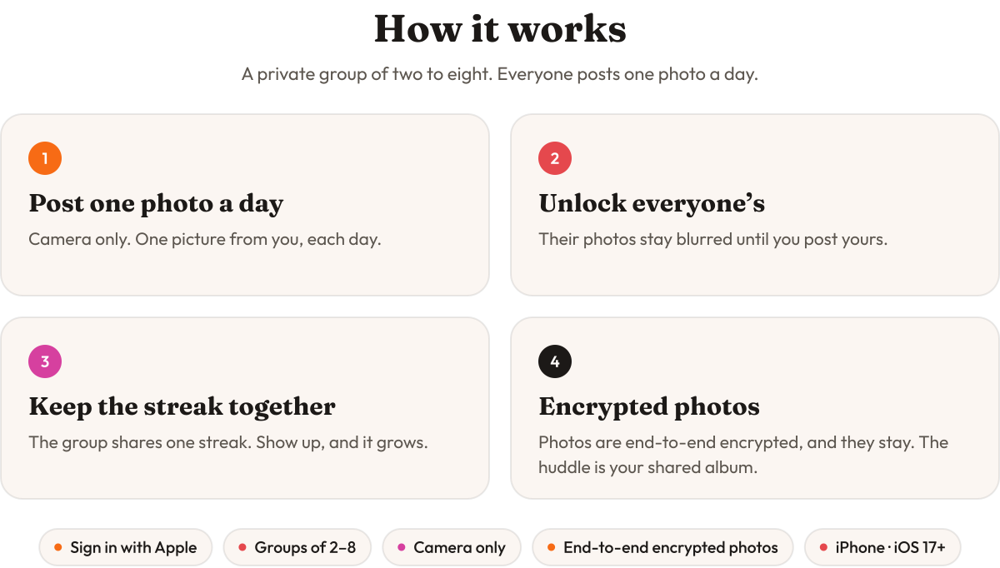

 
 

  <picture>
    <source media="(prefers-color-scheme: dark)" srcset="assets/headline-dark.svg">
    
  </picture>

  &nbsp;&nbsp;

  HuddlePals is in beta. Install TestFlight from the App Store, then tap the link to join.

 

<picture>
  <source media="(prefers-color-scheme: dark)" srcset="assets/how-it-works-dark.svg">
  
</picture>

 
 

  <a href="https://huddlepals.com/about">About</a>&nbsp;&nbsp;·&nbsp;&nbsp;<a href="https://huddlepals.com/privacy">Privacy</a>&nbsp;&nbsp;·&nbsp;&nbsp;<a href="https://huddlepals.com/terms">Terms</a>&nbsp;&nbsp;·&nbsp;&nbsp;<a href="https://huddlepals.com/support">Support</a>

