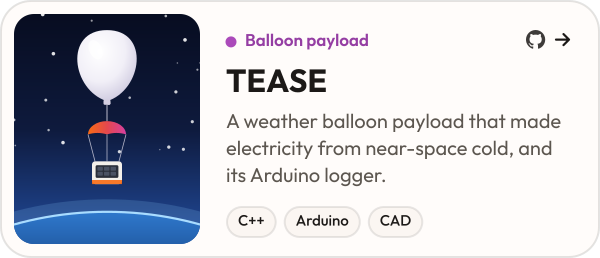

  <picture>
    <source media="(prefers-color-scheme: dark)" srcset="assets/projects-dark-3e61bf30.svg">
    
  </picture>

  

  

  
  

The HuddlePals app and website repositories are private. [Contact me to request access](https://huddlepals.com/support#repository-access) with your GitHub username, which repository you would like to view (app, website, or both), and why. Access is granted only after I review and approve your request.
